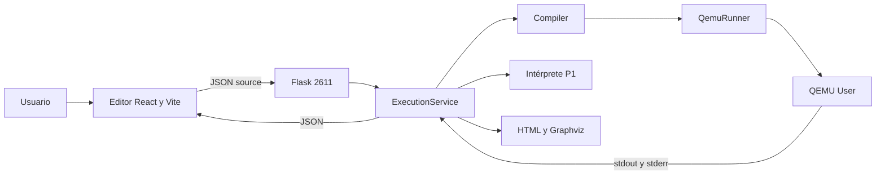
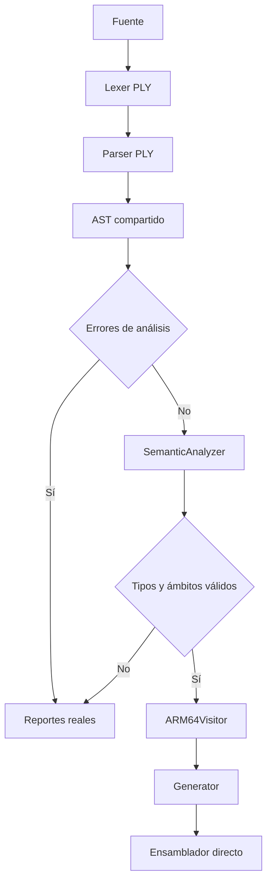
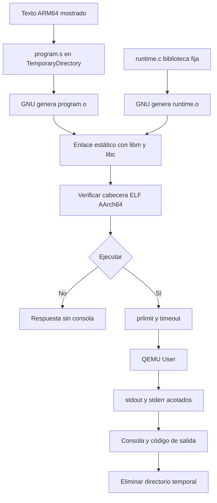
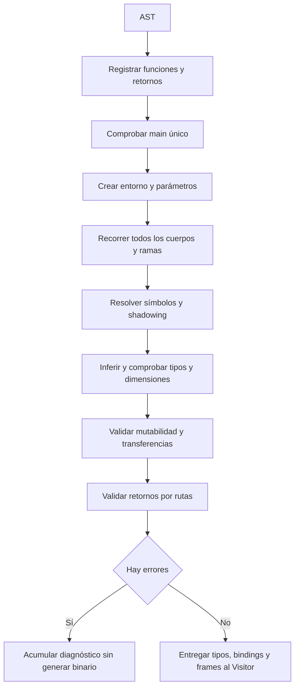

# Arquitectura

La aplicación conserva la organización cliente/servidor. `App.tsx` envía el texto por HTTP a Flask. `ExecutionService.execute` elige el compilador o `interpret` según el endpoint. El puerto continúa siendo 2611. No hay servicio externo de compilación.

## Flujo de compilación

`Compiler.compile` protege PLY con `analysis_lock`, conserva el AST y copia los errores antes de liberar el bloqueo. `SemanticAnalyzer` registra primero firmas y después recorre todos los cuerpos; admite referencias a funciones posteriores y recursividad. Los mapas de tipos y símbolos se indexan por identidad de nodo y no se agregan al AST, para que los reportes no recorran entornos circulares.

## Ejecución nativa

No se genera C a partir del programa ni código de tres direcciones. El C fijo de runtime es biblioteca de funciones nativas que GCC compila para ARM64. Los operadores, saltos, cortocircuito, funciones y frames del programa se emiten desde Python directamente en ensamblador.

## Análisis semántico

## Concurrencia y reportes

PLY usa variables globales; un bloqueo reentrante evita cruzar fuentes y errores. Cada ejecución de GNU/QEMU tiene archivos propios. El servicio serializa sus solicitudes, y los endpoints de reportes conservan la semántica anterior: muestran la última ejecución global, no un historial por usuario. La respuesta JSON conserva su AST y símbolos independientes.
