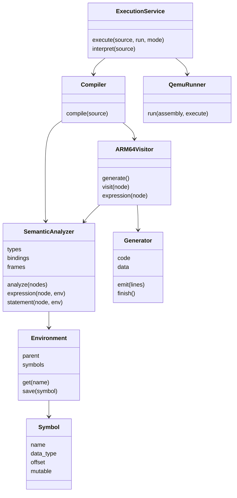

# Clases y métodos principales

## Compiler — backend/compiler/compiler.py

Coordina una compilación. `compile(source: str)` devuelve un diccionario con success, errors, symbols, assembly y nodes. Usa el parser compartido, SemanticAnalyzer y ARM64Visitor. El bloqueo de módulo `analysis_lock` protege el estado global PLY. No guarda estado entre compilaciones.

## SemanticAnalyzer — backend/compiler/semantic.py

Responsabilidad: validar sin ejecutar el programa y producir información para generación. Atributos: `errors` (ErrorManager), `types` (tipo por nodo), `bindings` (símbolo resuelto), `functions`, `returns`, `parameters`, `frames`, `symbols`, `loops` y `offset`.

| Método | Parámetros | Retorno y responsabilidad |
|---|---|---|
| analyze | lista de nodos globales | bool; registra firmas, main, parámetros y todos los cuerpos |
| block | nodos, entorno, child | None; crea ámbito y visita instrucciones |
| statement | nodo, entorno | None; declaraciones, asignación, control, retornos |
| expression | nodo, entorno | tipo escalar o tupla; anota tipos y bindings |
| native | NativeCall, entorno | tipo; valida firma y receptor de cada nativa |
| binary_type | nodo, tipo izquierdo, derecho, operador | tipo del resultado o unknown con error |
| compare_type | nodo, tipo izquierdo, derecho | None; comprueba tabla de comparaciones |
| coerce_array | ArrayLiteral, tipo esperado | tipo; permite promoción de literales y preserva dimensiones |
| constant_int | nodo | int o None; reconoce índices constantes sencillos |
| always_returns | lista de instrucciones | bool; validación conservadora de retorno por rutas |
| save | nodo, entorno, nombre, tipo, mutabilidad y estado | Symbol con nuevo slot de Stack |
| error | nodo, descripción | None; registra posición y fragmento |

## Environment y Symbol — backend/compiler/environment.py

`Environment(parent=None, name='global')` conserva `parent`, `name` y diccionario `symbols`. `get(name)` busca desde el entorno actual hacia los padres; `save(symbol)` reemplaza la entrada visible para shadowing. El historial de símbolos permanece en SemanticAnalyzer, incluidos símbolos sombreados.

`Symbol` es una dataclass de campos `name`, `data_type`, `mutable`, `offset`, `scope`, `line`, `column`, `initialized` y `kind`. No contiene valores calculados en Python. Los reportes muestran una ubicación estática de Stack, no un valor final supuesto.

## ARM64Visitor — backend/compiler/visitor.py

Atributos: `semantic`, `g` (Generator), `loops` (etiquetas activas), `return_label` y `current_return`. `generate()` devuelve el texto ensamblador. `function(name,node)` crea prólogo/epílogo y guarda parámetros. `visit(node)` traduce instrucciones; `expression(node)` traduce expresiones a x0 o d0. `address(node)` produce dirección de variable, elemento o descriptor de submatriz.

`operation(left,right,operator)` consume el operando izquierdo apilado y el derecho en registro; devuelve el tipo emitido. `compare(left,right,operator)` emite comparación y bool. `call(label,args,expected,result)` prepara los bancos de argumentos y Stack según AAPCS64; el parámetro result documenta el tipo retornado, que los consumidores conocen por semántica. `native(node)` selecciona helpers y operaciones directas. `push`, `pop`, `convert` y `local_address` son auxiliares sencillos.

## Generator — backend/compiler/generator.py

Atributos: `code`, `data`, `counter`, `descriptors`. Métodos: `emit(*lines)` agrega líneas; `label(prefix)` devuelve etiqueta única; `integer(value,register)` carga inmediato; `floating(value)` conserva bits IEEE-754; `address(label,register)` direcciona un símbolo; `string(value)` emite bytes UTF-8; `descriptor(type)` emite Type y devuelve su etiqueta; `finish()` devuelve el `.s` completo con secciones.

## QemuRunner — backend/runner/qemu_runner.py

Atributos: `timeout`, `gcc`, `qemu`, `runtime`. `available()` comprueba herramientas. `run(assembly,execute=True)` devuelve stdout, stderr, exit_code, tiempos, commands, stage y architecture tras verificar ELF. Los archivos pertenecen a un TemporaryDirectory que se elimina al finalizar. `execute=False` conserva el ensamblado y enlace, pero omite QEMU. Las excepciones se reservan para procesos, timeout y sistema de archivos.

## Clases conservadas

| Clase / archivo | Atributos relevantes | Métodos y función |
|---|---|---|
| Node, backend/ast/node.py | line, column | Base de nodos compartidos |
| Literal, backend/ast/expressions/literal.py | value, data_type | evaluate/get_type del intérprete; Visitor lee atributos |
| Identifier, backend/ast/expressions/identifier.py | name | Resolución dinámica original |
| Arithmetic/Relational/Logical | left, right, operator | Evaluación original; generación independiente |
| NativeCall/FunctionCall | name, arguments, target cuando corresponde | Llamadas dinámicas originales |
| ArrayLiteral, backend/ast/expressions/array_literal.py | expressions, repeat | Nuevo nodo compartido con evaluate/get_type/get_element_type |
| Declaration/Assignment | nombre/tipo/mutabilidad o target/operator | Ejecución del intérprete; binding estático externo |
| FunctionDeclaration/MainFunction | parámetros, instrucciones, retorno | Registro/ejecución original y lectura por Visitor |
| ErrorManager, backend/errors/error_manager.py | errors | semantic/lexical/syntactic, to_list, has_errors |
| Interpreter, backend/interpreter/interpreter.py | global_environment, error_manager | execute, execute_block, get_errors/get_console/get_all_symbols |
| ExecutionService, backend/service.py | last_result, HTML, DOT, SVG | execute selecciona flujo; interpret conserva Proyecto 1 |

## Diagrama de clases reales

