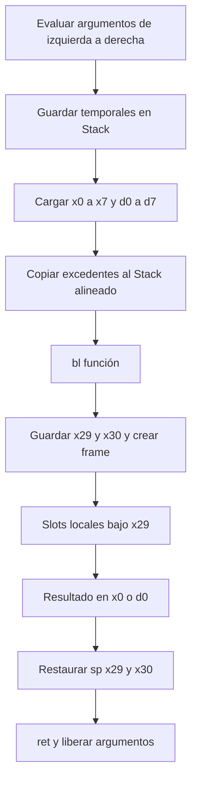

# Generación ARM64

`ARM64Visitor` recorre los atributos del AST creado por PLY. `Generator` almacena líneas de ensamblador, etiquetas únicas, bytes UTF-8 y descriptores de tipo. No invoca `evaluate` ni `execute` de los nodos. El runtime fijo se encuentra en `backend/compiler/runtime.c`.

## Registros e instrucciones

| Uso | Registros e instrucciones |
|---|---|
| i32 | w0/w1/w2; add, sub, mul, sdiv, msub; sxtw extiende el resultado |
| f64 | d0/d1/d2; fadd, fsub, fmul, fdiv, fneg, fabs, fsqrt, fcmp |
| Promoción | scvtf d0,w0 convierte i32 a f64 |
| Valores grandes | movz/movk por bloques de 16 bits |
| Direcciones | adrp y add con :lo12: |
| Comparaciones | cmp/fcmp y cset; String llama strcmp |
| Condiciones | cbz/cbnz, b y etiquetas; el RHS de &&/|| se salta realmente |
| Memoria | ldr/str, stp/ldp y desplazamientos calculados |
| Llamadas | bl y ret; x29 frame pointer y x30 retorno |

La división entera trunca hacia cero y el resto conserva el signo del dividendo, de acuerdo con sdiv/msub. El módulo decimal llama `fmod`. El código comprueba divisores cero antes de operar. i32 tiene aritmética de 32 bits con envolvimiento; no se implementan trampas de overflow. Bool usa 0/1 y char un punto de código Unicode. Los slots locales y elementos escalares ocupan 8 bytes para simplificar direcciones; el significado i32 sigue siendo de 32 bits.

## Stack y ABI

Cada función guarda x29/x30, establece x29 y reserva el tamaño de locales redondeado a 16. Cada variable/parametro tiene un offset negativo propio de 8 bytes. El sombreado obtiene un nuevo slot. Los temporales se apilan en slots de 16 bytes, por lo que `sp` permanece alineado durante llamadas anidadas.

Los argumentos enteros/punteros usan x0–x7 y los f64 d0–d7, en bancos independientes. Los excedentes se copian al Stack del llamador en posiciones de 8 bytes y con reserva total alineada. El receptor los lee desde x29+16. Se probaron funciones de diez parámetros tanto i32 como f64. El retorno usa x0 o d0. El código generado no modifica x19–x28 ni d8–d15. Los helpers C respetan la misma ABI.



## Heap y arreglos

`allocate` usa calloc y contabiliza un máximo acumulado de 64 MiB. Las asignaciones sobreviven hasta la salida del proceso; no hay recolector ni free individual. Así un String o arreglo retornado no apunta al frame de una función terminada. Cada ejecución termina su proceso y recupera todo el Heap.

`Type` contiene cuatro palabras: categoría, tamaño en bytes, puntero al tipo hijo y longitud estática. Categorías: 1=i32, 2=f64, 3=bool, 4=char, 5=String, 6=arreglo. El generador emite estos descriptores en `.rodata`.

`Array` es un descriptor de tres palabras (24 bytes): longitud, puntero a los datos y puntero al tipo de elemento. Los datos de matrices se aplanan en un bloque único contiguo **Row-Major**. Una submatriz o slice crea únicamente otro descriptor y referencia los datos originales.

Para dimensiones d0…dn e índices i0…in, el índice lineal es `sum(ik * product(dj para j>k))`. El offset de bytes es ese índice multiplicado por 8. Para una matriz con C columnas: `(fila*C+columna)*8`. `ox_index` utiliza `índice*element.size`; `ox_subarray` conserva la longitud y tipo de la dimensión siguiente. Cada dimensión comprueba índice no negativo y menor que longitud. Se detectan además índices literales y expresiones enteras constantes sencillas fuera de rango durante semántica.

Los literales anidados se compilan como arreglos temporales y se copian al bloque contiguo final. `ArrayLiteral` repetido evalúa una sola vez su inicializador. Un slice `[inicio..fin]` valida `0 <= inicio <= fin <= longitud` y comparte datos. `clone` copia el bloque de datos; Strings dentro de arreglos siguen compartiendo cadenas inmutables. Las variables de arreglo guardan punteros a descriptores y la asignación entre variables comparte el descriptor. La asignación de una submatriz copia sus datos. No se implementa el sistema de ownership/borrow checker de Rust.

## Strings y biblioteca

Strings son punteros a bytes UTF-8 terminados en NUL. Literales se copian al Heap cuando son valores; los textos fijos de formato pueden imprimirse directamente desde `.rodata`. El parser decodifica escapes y conserva raw strings. `len` cuenta puntos de código Unicode, `chars` devuelve un arreglo de chars y `contains`, `replace`, `split`, concatenación y repetición operan dentro del binario. `to_uppercase`/`to_lowercase` usan la configuración C.UTF-8 y las conversiones de libc; no incluyen expansiones Unicode de varios caracteres como ß→SS.

`println!` evalúa primero sus argumentos y los guarda; después imprime fragmentos de formato y valores tipados mediante `ox_print`. Los textos se pasan a fputs, nunca como formato printf controlado por el usuario. Los arreglos se imprimen recursivamente, entre corchetes, con Strings entre comillas. `f64` se imprime con 15 dígitos significativos y `.0` para valores integrales finitos. No hay resultado de impresión calculado por Python.

`typeof` se resuelve a partir del tipo estático; no evalúa el argumento. `random` utiliza el PRNG de libc inicializado en main y devuelve valores inclusivos. No tiene fines criptográficos. `abs`, `sqrt`, `clone` y `chars` se mantienen además como extensiones compatibles.

## Ejemplo real

`examples/demo.s` fue generado de `examples/demo.oxs` y ejecutado en QEMU. Fragmento de suma recursiva real de Fibonacci:

```asm
    ldr x1, [sp], #16
    add w0, w1, w0
    sxtw x0, w0
    b .L_return_1
```

Para reproducir: compilar con `ExecutionService` y guardar `result['assembly']`; ensamblar con GNU, compilar el runtime y enlazar ambos objetos estáticamente con `-lm`. El README contiene los comandos exactos. El runner verifica el magic ELF y `e_machine=183` antes de QEMU.
