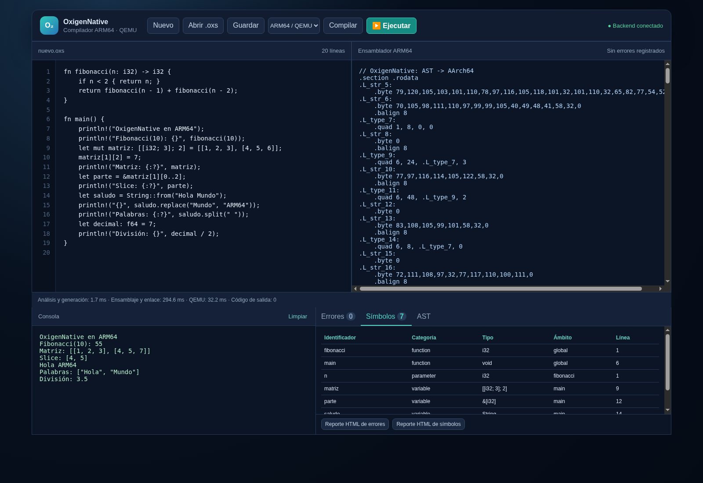

# Pruebas ejecutadas

Fecha: 15 de octubre de 2026. Entorno de verificación: Debian 13 administrado, Python 3.12, GNU AArch64 14.2 y QEMU 10.0.13. La instalación Ubuntu equivalente está en README. Las herramientas cruzadas se extrajeron localmente porque el entorno no permite instalación de sistema.

## Resultado final

**15 métodos unittest aprobados, sin omisiones**, con casos agrupados por categorías. Incluyen 40 programas válidos compilados, ensamblados, enlazados y ejecutados en QEMU; 44 fuentes negativas; siete fallos dinámicos; ABI de diez parámetros i32/f64; timeout; límite de salida; API; concurrencia del parser; y regresión del intérprete.

El [registro completo](evidencias/unittest.txt) corresponde a la última ejecución. Cada prueba nativa comprueba cabecera ELF AArch64, código de salida y stdout real. Ninguna salida válida fue producida por el intérprete.

```bash
python -m unittest discover -s tests -v
cd frontend/frontend
npm run build
npm run lint
```

En este entorno ya preparado se activa `source /workspace/toolchain/env.sh` antes de las pruebas. Ese archivo selecciona el venv existente y las herramientas bajo /workspace/toolchain. No es necesario en una instalación Ubuntu estándar con los ejecutables en PATH.

## Programas válidos

| Prueba | Funcionalidad | Entrada | Resultado esperado | Resultado real | Estado |
|---|---|---|---|---|---|
| lexer_comments | lexer comments | <code>/* comentario<br> múltiple */ fn main(){// línea<br> println!(&quot;á\nβ&quot;);}</code> | á<br>β | á<br>β; exit=0 | Aprobada |
| defaults | defaults | <code>fn main(){let a:i32;let b:f64;let c:bool;let d:String;println!(&quot;{} {} {} {}&quot;,a,b,c,d);}</code> | 0 0.0 false  | 0 0.0 false ; exit=0 | Aprobada |
| variables | variables | <code>fn main(){let x=1;let x=2;{let x=3;println!(x);}let mut y=x;y+=5;y*=2;y-=1;y/=3;y%=3;println!(y);println!(x);}</code> | 3<br>1<br>2 | 3<br>1<br>2; exit=0 | Aprobada |
| integer_arithmetic | integer arithmetic | <code>fn main(){println!(&quot;{} {} {} {} {}&quot;,8+2,8-2,8*2,9/2,9%2);println!(-9/2);println!(-9%2);}</code> | 10 6 16 4 1<br>-4<br>-1 | 10 6 16 4 1<br>-4<br>-1; exit=0 | Aprobada |
| float_arithmetic | float arithmetic | <code>fn main(){println!(&quot;{} {} {} {} {}&quot;,1+2.5,5.5-2,2*1.5,5.0/2,5.5%2);}</code> | 3.5 3.5 3.0 2.5 1.5 | 3.5 3.5 3.0 2.5 1.5; exit=0 | Aprobada |
| relations | relations | <code>fn main(){println!(&quot;{} {} {} {} {} {}&quot;,1==1.0,1!=2,3&gt;2.0,3&gt;=3,2&lt;3,2&lt;=2);println!(&quot;a&quot;&lt;&quot;b&quot;);println!(false&lt;true);println!(65==&#x27;A&#x27;);}</code> | true true true true true true<br>true<br>true<br>true | true true true true true true<br>true<br>true<br>true; exit=0 | Aprobada |
| logic | logic | <code>fn side()-&gt;bool{println!(&quot;side&quot;);return true;}fn main(){println!(false&amp;&amp;side());println!(true&#124;&#124;side());println!(!false&amp;&amp;true);}</code> | false<br>true<br>true | false<br>true<br>true; exit=0 | Aprobada |
| if_else | if else | <code>fn main(){if false{println!(1);}else if true{println!(2);}else{println!(3);}}</code> | 2 | 2; exit=0 | Aprobada |
| while | while | <code>fn main(){let mut i=0;while i&lt;5{i+=1;if i==2{continue;}if i==4{break;}println!(i);}}</code> | 1<br>3 | 1<br>3; exit=0 | Aprobada |
| loop_labels | loop labels | <code>fn main(){let mut i=0;&#x27;outer:loop{i+=1;loop{if i&lt;3{continue &#x27;outer;}break &#x27;outer;}}println!(i);}</code> | 3 | 3; exit=0 | Aprobada |
| match | match | <code>fn main(){let n=2;match n{1=&gt;println!(&quot;uno&quot;),2=&gt;{println!(&quot;dos&quot;);},_=&gt;println!(&quot;otro&quot;),}}</code> | dos | dos; exit=0 | Aprobada |
| match_float | match float | <code>fn main(){let n=2.5;match n{1.0=&gt;println!(1),2.5=&gt;println!(2),_=&gt;println!(3),}}</code> | 2 | 2; exit=0 | Aprobada |
| match_string | match string | <code>fn main(){match &quot;b&quot;{&quot;a&quot;=&gt;println!(1),&quot;b&quot;=&gt;println!(2),_=&gt;println!(3),}}</code> | 2 | 2; exit=0 | Aprobada |
| functions | functions | <code>fn add(a:i32,b:i32)-&gt;i32{return a+b;}fn hello(s:String){println!(&quot;Hola {}&quot;,s);}fn main(){hello(&quot;Ana&quot;);println!(add(10,20));}</code> | Hola Ana<br>30 | Hola Ana<br>30; exit=0 | Aprobada |
| recursion | recursion | <code>fn fib(n:i32)-&gt;i32{if n&lt;2{return n;}return fib(n-1)+fib(n-2);}fn main(){println!(fib(10));}</code> | 55 | 55; exit=0 | Aprobada |
| float_abi | float abi | <code>fn sum(a:f64,b:i32,c:f64)-&gt;f64{return a+b+c;}fn main(){println!(sum(1.5,2,3.25));}</code> | 6.75 | 6.75; exit=0 | Aprobada |
| int_to_float_return | int to float return | <code>fn f()-&gt;f64{return 7;}fn main(){println!(f());}</code> | 7.0 | 7.0; exit=0 | Aprobada |
| array | array | <code>fn main(){let mut a:[i32;3]=[1,2,3];a[1]+=5;println!(a);println!(a.len());}</code> | [1, 7, 3]<br>3 | [1, 7, 3]<br>3; exit=0 | Aprobada |
| array_repeat | array repeat | <code>fn value()-&gt;i32{println!(&quot;once&quot;);return 3;}fn main(){let a=[value();3];println!(a);}</code> | once<br>[3, 3, 3] | once<br>[3, 3, 3]; exit=0 | Aprobada |
| matrix | matrix | <code>fn main(){let mut a:[[i32;3];2]=[[1,2,3],[4,5,6]];a[1][2]=7;println!(a);println!(a[1][2]);}</code> | [[1, 2, 3], [4, 5, 7]]<br>7 | [[1, 2, 3], [4, 5, 7]]<br>7; exit=0 | Aprobada |
| cube | cube | <code>fn main(){let a=[[[1,2],[3,4]],[[5,6],[7,8]]];println!(a[1][0][1]);}</code> | 6 | 6; exit=0 | Aprobada |
| subarray_assignment | subarray assignment | <code>fn main(){let mut a=[[1,2],[3,4]];a[0]=[8,9];println!(a);}</code> | [[8, 9], [3, 4]] | [[8, 9], [3, 4]]; exit=0 | Aprobada |
| slices | slices | <code>fn main(){let mut a=[10,20,30,40];let b=&amp;a[1..3];a[1]=99;println!(b);println!(b.len());}</code> | [99, 30]<br>2 | [99, 30]<br>2; exit=0 | Aprobada |
| array_functions | array functions | <code>fn sum(a:[i32;3])-&gt;i32{return a[0]+a[1]+a[2];}fn main(){println!(sum([1,2,3]));}</code> | 6 | 6; exit=0 | Aprobada |
| array_return | array return | <code>fn pair()-&gt;[i32;2]{return [1,2];}fn main(){println!(pair());}</code> | [1, 2] | [1, 2]; exit=0 | Aprobada |
| float_array_return | float array return | <code>fn f()-&gt;[f64;2]{return [1,2];}fn main(){println!(f());}</code> | [1.0, 2.0] | [1.0, 2.0]; exit=0 | Aprobada |
| float_array_assignment | float array assignment | <code>fn main(){let mut a:[f64;2]=[1,2];a=[3,4];println!(a);}</code> | [3.0, 4.0] | [3.0, 4.0]; exit=0 | Aprobada |
| float_array | float array | <code>fn main(){let a:[f64;2]=[1,2];println!(a);println!(a.contains(2));}</code> | [1.0, 2.0]<br>true | [1.0, 2.0]<br>true; exit=0 | Aprobada |
| strings | strings | <code>fn main(){let a=String::from(&quot;Hola&quot;);let mut b=String::new();b+=&quot;Mundo&quot;;println!(a+&quot; &quot;+b);println!(&quot;ab&quot;*3);println!(2*&quot;xy&quot;);}</code> | Hola Mundo<br>ababab<br>xyxy | Hola Mundo<br>ababab<br>xyxy; exit=0 | Aprobada |
| string_escapes | string escapes | <code>fn main(){println!(&quot;a\t\&quot;b\&quot;\\c&quot;);println!(r&quot;a\nb&quot;);}</code> | a	&quot;b&quot;\c<br>a\nb | a	&quot;b&quot;\c<br>a\nb; exit=0 | Aprobada |
| string_methods | string methods | <code>fn main(){let s=&quot;Hola Mundo&quot;;println!(s.len());println!(s.contains(&quot;Mundo&quot;));println!(s.replace(&quot;Mundo&quot;,&quot;Rust&quot;));println!(s.split(&quot; &quot;));println!(s.to_uppercase());println!(s.to_lowercase());}</code> | 10<br>true<br>Hola Rust<br>[&quot;Hola&quot;, &quot;Mundo&quot;]<br>HOLA MUNDO<br>hola mundo | 10<br>true<br>Hola Rust<br>[&quot;Hola&quot;, &quot;Mundo&quot;]<br>HOLA MUNDO<br>hola mundo; exit=0 | Aprobada |
| unicode | unicode | <code>fn main(){let s=&quot;niño β&quot;;println!(s.len());println!(s.contains(&#x27;ñ&#x27;));println!(s.chars());println!(&#x27;😀&#x27;);}</code> | 6<br>true<br>[n, i, ñ, o,  , β]<br>😀 | 6<br>true<br>[n, i, ñ, o,  , β]<br>😀; exit=0 | Aprobada |
| string_construction | string construction | <code>fn main(){println!(String::from(12));println!(String::from(1.5));println!(String::from(true));println!(String::from(&#x27;A&#x27;));}</code> | 12<br>1.5<br>true<br>A | 12<br>1.5<br>true<br>A; exit=0 | Aprobada |
| natives | natives | <code>fn main(){let mut a=[1,2,3];let b=a.clone();a.reverse();println!(a);println!(b);println!(a.contains(2));println!(typeof(a));println!(abs(-5));println!(sqrt(9));let r=random(1,3);println!(r&gt;=1&amp;&amp;r&lt;=3);}</code> | [3, 2, 1]<br>[1, 2, 3]<br>true<br>[i32; 3]<br>5<br>3.0<br>true | [3, 2, 1]<br>[1, 2, 3]<br>true<br>[i32; 3]<br>5<br>3.0<br>true; exit=0 | Aprobada |
| empty_typed_array | empty typed array | <code>fn main(){let a:[i32;0]=[];println!(a);}</code> | [] | []; exit=0 | Aprobada |
| matrix_return | matrix return | <code>fn f()-&gt;[[i32;2];2]{return [[1,2],[3,4]];}fn main(){println!(f()[1][0]);}</code> | 3 | 3; exit=0 | Aprobada |
| matrix_float | matrix float | <code>fn main(){let a:[[f64;2];2]=[[1,2],[3,4]];println!(a);}</code> | [[1.0, 2.0], [3.0, 4.0]] | [[1.0, 2.0], [3.0, 4.0]]; exit=0 | Aprobada |
| integer_limits | integer limits | <code>fn main(){println!(-2147483648);println!(2147483647+1);}</code> | -2147483648<br>-2147483648 | -2147483648<br>-2147483648; exit=0 | Aprobada |
| strings_array | strings array | <code>fn main(){let a=[&quot;uno&quot;,&quot;dos&quot;];println!(a.contains(&quot;dos&quot;));println!(a[1]);}</code> | true<br>dos | true<br>dos; exit=0 | Aprobada |
| match_transfer | match transfer | <code>fn main(){let mut i=0;while i&lt;3{i+=1;match i{1=&gt;continue,2=&gt;println!(i),_=&gt;break,}}println!(i);}</code> | 2<br>3 | 2<br>3; exit=0 | Aprobada |

## Errores estáticos

Todos los casos deben producir errores y `assembly` vacío; no se invocan GNU ni QEMU para estas fuentes.

| Prueba | Funcionalidad | Entrada | Resultado esperado | Resultado real | Estado |
|---|---|---|---|---|---|
| lexical | Validación estática | <code>fn main(){let a=@1;}</code> | Diagnóstico y assembly vacío | Diagnóstico y assembly vacío | Aprobada |
| comment_unclosed | Validación estática | <code>fn main(){} /* abierto</code> | Diagnóstico y assembly vacío | Diagnóstico y assembly vacío | Aprobada |
| syntax_semicolon | Validación estática | <code>fn main(){let a=1 println!(a);}</code> | Diagnóstico y assembly vacío | Diagnóstico y assembly vacío | Aprobada |
| syntax_brace | Validación estática | <code>fn main(){println!(1);</code> | Diagnóstico y assembly vacío | Diagnóstico y assembly vacío | Aprobada |
| missing_main | Validación estática | <code>fn other(){}</code> | Diagnóstico y assembly vacío | Diagnóstico y assembly vacío | Aprobada |
| duplicate_main | Validación estática | <code>fn main(){}fn main(){}</code> | Diagnóstico y assembly vacío | Diagnóstico y assembly vacío | Aprobada |
| duplicate_function | Validación estática | <code>fn f(){}fn f(){}fn main(){}</code> | Diagnóstico y assembly vacío | Diagnóstico y assembly vacío | Aprobada |
| main_parameters | Validación estática | <code>fn main(x:i32){}</code> | Diagnóstico y assembly vacío | Diagnóstico y assembly vacío | Aprobada |
| undeclared | Validación estática | <code>fn main(){println!(x);}</code> | Diagnóstico y assembly vacío | Diagnóstico y assembly vacío | Aprobada |
| scope | Validación estática | <code>fn main(){{let x=1;}println!(x);}</code> | Diagnóstico y assembly vacío | Diagnóstico y assembly vacío | Aprobada |
| immutability | Validación estática | <code>fn main(){let x=1;x=2;}</code> | Diagnóstico y assembly vacío | Diagnóstico y assembly vacío | Aprobada |
| array_immutability | Validación estática | <code>fn main(){let a=[1,2];a[0]=3;}</code> | Diagnóstico y assembly vacío | Diagnóstico y assembly vacío | Aprobada |
| type_assignment | Validación estática | <code>fn main(){let mut x=1;x=&quot;bad&quot;;}</code> | Diagnóstico y assembly vacío | Diagnóstico y assembly vacío | Aprobada |
| bad_condition | Validación estática | <code>fn main(){if 1{println!(1);}}</code> | Diagnóstico y assembly vacío | Diagnóstico y assembly vacío | Aprobada |
| unreachable_error | Validación estática | <code>fn main(){if false{println!(missing);}}</code> | Diagnóstico y assembly vacío | Diagnóstico y assembly vacío | Aprobada |
| unused_function_error | Validación estática | <code>fn bad(){println!(missing);}fn main(){}</code> | Diagnóstico y assembly vacío | Diagnóstico y assembly vacío | Aprobada |
| uninitialized | Validación estática | <code>fn main(){let c:char;println!(c);}</code> | Diagnóstico y assembly vacío | Diagnóstico y assembly vacío | Aprobada |
| uninferred | Validación estática | <code>fn main(){let x;}</code> | Diagnóstico y assembly vacío | Diagnóstico y assembly vacío | Aprobada |
| argument_count | Validación estática | <code>fn f(x:i32){}fn main(){f();}</code> | Diagnóstico y assembly vacío | Diagnóstico y assembly vacío | Aprobada |
| argument_type | Validación estática | <code>fn f(x:i32){}fn main(){f(&quot;bad&quot;);}</code> | Diagnóstico y assembly vacío | Diagnóstico y assembly vacío | Aprobada |
| unknown_function | Validación estática | <code>fn main(){missing();}</code> | Diagnóstico y assembly vacío | Diagnóstico y assembly vacío | Aprobada |
| duplicate_parameters | Validación estática | <code>fn f(x:i32,x:i32){}fn main(){}</code> | Diagnóstico y assembly vacío | Diagnóstico y assembly vacío | Aprobada |
| return_type | Validación estática | <code>fn f()-&gt;i32{return &quot;bad&quot;;}fn main(){}</code> | Diagnóstico y assembly vacío | Diagnóstico y assembly vacío | Aprobada |
| return_path | Validación estática | <code>fn f(x:bool)-&gt;i32{if x{return 1;}}fn main(){}</code> | Diagnóstico y assembly vacío | Diagnóstico y assembly vacío | Aprobada |
| main_return | Validación estática | <code>fn main(){return 1;}</code> | Diagnóstico y assembly vacío | Diagnóstico y assembly vacío | Aprobada |
| break | Validación estática | <code>fn main(){break;}</code> | Diagnóstico y assembly vacío | Diagnóstico y assembly vacío | Aprobada |
| label | Validación estática | <code>fn main(){loop{break &#x27;missing;}}</code> | Diagnóstico y assembly vacío | Diagnóstico y assembly vacío | Aprobada |
| logic_types | Validación estática | <code>fn main(){println!(1&amp;&amp;true);}</code> | Diagnóstico y assembly vacío | Diagnóstico y assembly vacío | Aprobada |
| arithmetic_types | Validación estática | <code>fn main(){println!(1+&quot;x&quot;);}</code> | Diagnóstico y assembly vacío | Diagnóstico y assembly vacío | Aprobada |
| array_size | Validación estática | <code>fn main(){let a:[i32;3]=[1,2];}</code> | Diagnóstico y assembly vacío | Diagnóstico y assembly vacío | Aprobada |
| array_shape | Validación estática | <code>fn main(){let a=[[1,2],[3]];}</code> | Diagnóstico y assembly vacío | Diagnóstico y assembly vacío | Aprobada |
| array_element | Validación estática | <code>fn main(){let a=[1,&quot;bad&quot;];}</code> | Diagnóstico y assembly vacío | Diagnóstico y assembly vacío | Aprobada |
| array_negative_constant | Validación estática | <code>fn main(){let a=[1,2];println!(a[-1]);}</code> | Diagnóstico y assembly vacío | Diagnóstico y assembly vacío | Aprobada |
| array_bounds | Validación estática | <code>fn main(){let a=[1,2];println!(a[2]);}</code> | Diagnóstico y assembly vacío | Diagnóstico y assembly vacío | Aprobada |
| array_index_type | Validación estática | <code>fn main(){let a=[1,2];println!(a[true]);}</code> | Diagnóstico y assembly vacío | Diagnóstico y assembly vacío | Aprobada |
| slice_bounds | Validación estática | <code>fn main(){let a=[1,2];let b=&amp;a[0..3];}</code> | Diagnóstico y assembly vacío | Diagnóstico y assembly vacío | Aprobada |
| format | Validación estática | <code>fn main(){println!(&quot;{} {}&quot;,1);}</code> | Diagnóstico y assembly vacío | Diagnóstico y assembly vacío | Aprobada |
| integer_range | Validación estática | <code>fn main(){println!(2147483648);}</code> | Diagnóstico y assembly vacío | Diagnóstico y assembly vacío | Aprobada |
| native_type | Validación estática | <code>fn main(){println!(1.len());}</code> | Diagnóstico y assembly vacío | Diagnóstico y assembly vacío | Aprobada |
| void_parameter | Validación estática | <code>fn f(a:void){}fn main(){}</code> | Diagnóstico y assembly vacío | Diagnóstico y assembly vacío | Aprobada |
| huge_array | Validación estática | <code>fn main(){let a:[i32;1000000000]=[0;1000000000];}</code> | Diagnóstico y assembly vacío | Diagnóstico y assembly vacío | Aprobada |
| bad_char_escape | Validación estática | <code>fn main(){println!(&#x27;\q&#x27;);}</code> | Diagnóstico y assembly vacío | Diagnóstico y assembly vacío | Aprobada |
| native_count | Validación estática | <code>fn main(){println!(&quot;x&quot;.replace(&quot;a&quot;));}</code> | Diagnóstico y assembly vacío | Diagnóstico y assembly vacío | Aprobada |
| reverse_mutability | Validación estática | <code>fn main(){let a=[1,2];a.reverse();}</code> | Diagnóstico y assembly vacío | Diagnóstico y assembly vacío | Aprobada |

## Errores dinámicos

| Prueba | Funcionalidad | Entrada | Resultado esperado | Resultado real | Estado |
|---|---|---|---|---|---|
| division_zero | Comprobación en ARM64 | <code>fn main(){let z=0;println!(1/z);}</code> | exit distinto de cero y stderr con Ejecución | Comprobados en QEMU | Aprobada |
| float_zero | Comprobación en ARM64 | <code>fn main(){let z=0.0;println!(1.0/z);}</code> | exit distinto de cero y stderr con Ejecución | Comprobados en QEMU | Aprobada |
| dynamic_bounds | Comprobación en ARM64 | <code>fn main(){let a=[1,2];let i=3;println!(a[i]);}</code> | exit distinto de cero y stderr con Ejecución | Comprobados en QEMU | Aprobada |
| negative_index | Comprobación en ARM64 | <code>fn main(){let a=[1,2];let i=-1;println!(a[i]);}</code> | exit distinto de cero y stderr con Ejecución | Comprobados en QEMU | Aprobada |
| negative_repeat | Comprobación en ARM64 | <code>fn main(){println!(&quot;a&quot; * -2);}</code> | exit distinto de cero y stderr con Ejecución | Comprobados en QEMU | Aprobada |
| random_range | Comprobación en ARM64 | <code>fn main(){println!(random(2,1));}</code> | exit distinto de cero y stderr con Ejecución | Comprobados en QEMU | Aprobada |
| negative_sqrt | Comprobación en ARM64 | <code>fn main(){println!(sqrt(-1));}</code> | exit distinto de cero y stderr con Ejecución | Comprobados en QEMU | Aprobada |

## Integración y límites

| Prueba | Entrada / operación | Resultado esperado y real | Estado |
|---|---|---|---|
| ABI | Funciones con diez i32 y diez f64 | 45 y 45.0 con exit 0 | Aprobada |
| Timeout | loop infinito con límite de 0.2 s | Diagnóstico de tiempo límite | Aprobada |
| Salida | 200000 líneas potenciales | Proceso detenido y archivo <=1 MiB | Aprobada |
| API | compile/execute/interpret, health y reportes | Compilar no imprime; ejecutar devuelve 42; mismo ARM64 | Aprobada |
| API inválida | JSON sin source o source numérico | HTTP 400 | Aprobada |
| Herramientas faltantes | Ruta de GCC inexistente | Error explícito sin éxito ficticio | Aprobada |
| Concurrencia | Doce compilaciones con cuatro threads | Todas conservan su análisis válido | Aprobada |
| No interpretar | Interpreter reemplazado por una excepción | El flujo nativo sigue imprimiendo 1 | Aprobada |
| Reportes | Programa con declaración | DOT real, SVG y símbolos | Aprobada |
| Regresión P1 | Archivo integral original, seed 2611 | 108 líneas idénticas a la base y cero errores | Aprobada |
| React | npm run build | TypeScript y Vite sin errores | Aprobada |
| Lint | npm run lint | oxlint sin errores | Aprobada |
| Mermaid | mermaid.parse en los bloques Markdown | Seis diagramas válidos | Aprobada |
| Chromium | Ejemplo desde el editor | Compilar, ejecutar, consola, tiempos, símbolos, AST y ancho móvil | Aprobada |
| Diálogos de archivos | Abrir y descargar archivos mediante sistema operativo | Comprobación manual adicional | No ejecutada |

La referencia de regresión `tests/fixtures/project1_console.json` se obtuvo ejecutando el intérprete original del commit `904cfa22afe8e1f1e747e9ed3544590a94356dc0` con semilla aleatoria fija. Es una expectativa de prueba, no una fuente de salida de la aplicación.

## Prueba de navegador reproducible

Inicie backend y frontend, luego Chromium con depuración local:

```bash
chromium --headless --no-sandbox --disable-dev-shm-usage --remote-debugging-port=9222 --user-data-dir=/tmp/oxigen-chrome about:blank
node tests/browser-smoke.mjs
```

El script usa el protocolo de depuración de Chromium mediante WebSocket nativo de Node; no agrega dependencias del frontend. `--no-sandbox` se utilizó únicamente para la prueba dentro del entorno administrado. La captura se guarda en docs/capturas/oxigennative-qemu.png.



## Correcciones durante verificación

Se encontraron y corrigieron dependencias/rutas del toolchain local, un tipo de puntero del runtime, preservación de argumentos en prólogo y conversiones de literales de arreglos f64. Las primeras ejecuciones fallidas no se contaron como aprobadas. El registro final se generó después de corregirlas.

Las limitaciones restantes están en el manual técnico. No se realizaron pruebas de despliegue público ni de equivalencia completa con Rust.
